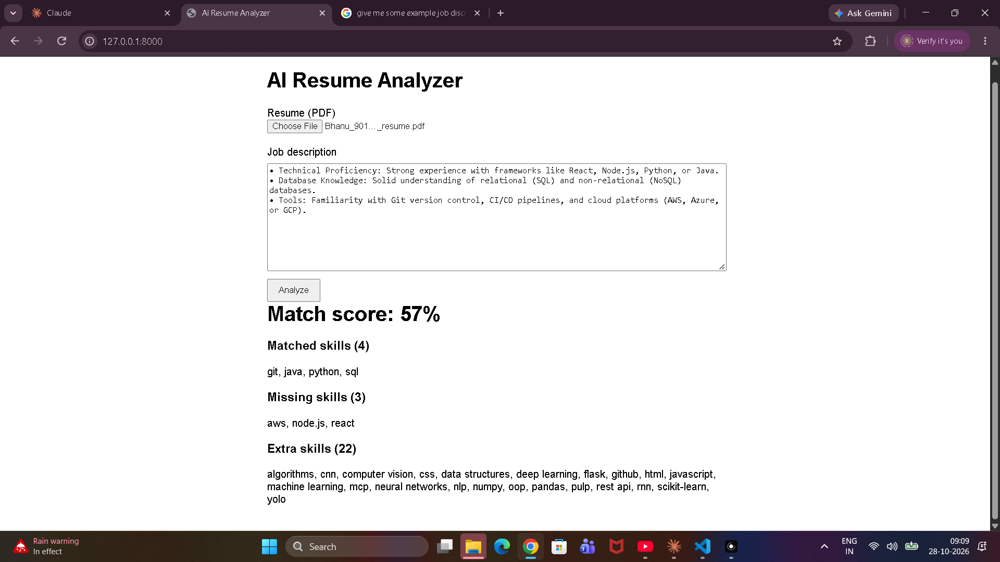

# AI Resume Analyzer API

A FastAPI web app that scores how well a resume matches a job description.
Upload a resume PDF, paste a job description, and get a match score plus
matched / missing / extra skill lists.

## Tech Stack

- Python, FastAPI (web framework)
- pdfplumber (PDF text extraction)
- Custom keyword + alias matching (`skills.py`)
- Plain HTML/CSS/JS frontend (`static/index.html`)

## Run it

```bash
python -m venv venv
venv\Scripts\activate
pip install fastapi uvicorn pdfplumber
uvicorn main:app --reload
```

Open <http://localhost:8000/app/> in your browser.

## API

| Method | Path        | Description                                  |
| ------ | ----------- | -------------------------------------------- |
| GET    | `/`         | Serves the HTML page (`static/index.html`)  |
| POST   | `/extract`  | Resume PDF (multipart) -> extracted text    |
| POST   | `/analyze`  | Resume PDF + `job_description` form -> score |

`/analyze` returns:

```json
{
  "score": 57,
  "matched": ["git", "java", "python", "sql"],
  "missing": ["aws", "node.js", "react"],
  "extra": ["algorithms", "cnn", "css", "..."]
}
```

Error codes: `400` if the file is not a PDF, `422` if no text could be read.

## Screenshot



## Known limitation

The score is keyword-based: it counts recognized skills found in both the
resume and job description. Generic job descriptions that mention only
2-3 known skills can produce misleadingly high scores. A semantic
(TF-IDF + cosine similarity) pass is planned to complement it.